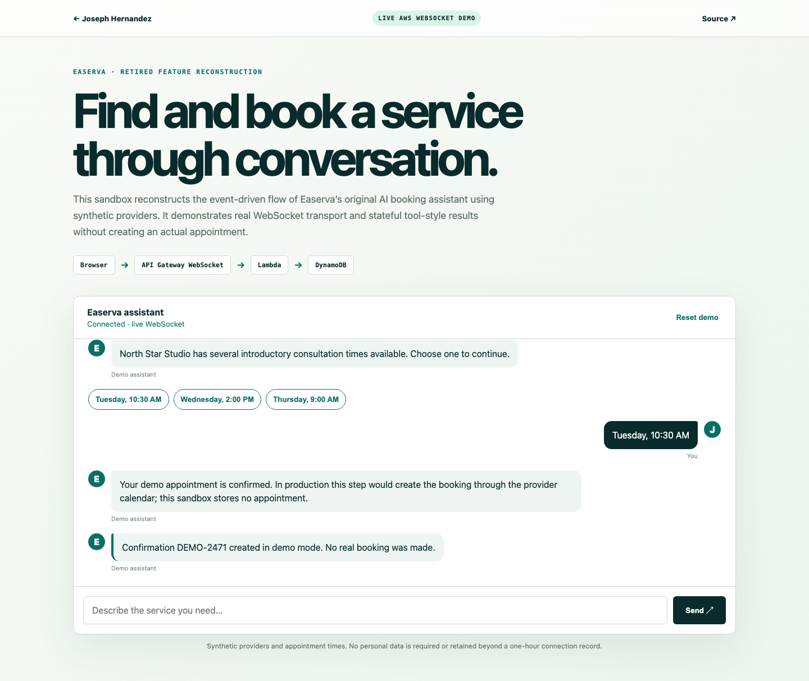

# Easerva Conversational Booking Demo

A public, synthetic reconstruction of the real-time conversational booking subsystem formerly built for Easerva.

**Live demo:** <https://josephmhernandez.com/demos/easerva/>



## What it demonstrates

- A real API Gateway WebSocket connection
- Dynamic Anthropic Claude responses through Amazon Bedrock
- Typed, event-oriented response concepts (`ai.delta`, provider recommendations, time slots, confirmation)
- Stateful multi-step service discovery
- DynamoDB session state with one-hour expiry
- Serverless infrastructure with no idle compute charge

The public demo uses Claude for natural conversation around a bounded state machine and synthetic providers. Structured provider/time events remain deterministic so the demo cannot invent a real business or appointment. It does not expose Easerva customers, production booking data, private prompts, or production credentials. The original system integrated Claude, MCP tools, XState, Supabase persistence, authentication, and calendar booking.

## Architecture

```text
Static browser client
        │ WebSocket
        ▼
API Gateway WebSocket API
        │
        ▼
AWS Lambda ─── Anthropic Claude on Bedrock
        │
        └────── DynamoDB session state
```

## Local verification

```bash
cd backend
npm install
npm test
```

Serve `web/` with any static server. A deployed WebSocket URL is written to `web/config.js` during deployment.

## Deploy

```bash
sam build
sam deploy --stack-name easerva-booking-demo --resolve-s3 --capabilities CAPABILITY_IAM
```

## Privacy

No registration is required. Inputs are limited to 500 characters. The public demo stores a short recent-message window with the connection and workflow state; the entire record expires through a one-hour DynamoDB TTL. No payment or real booking is created.

## License

MIT
